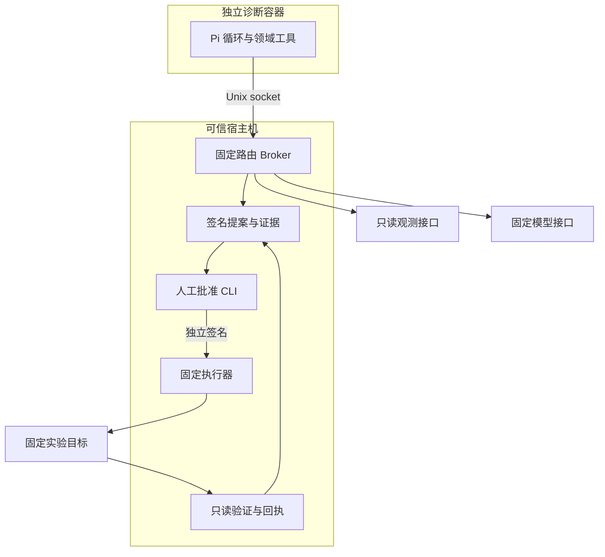

# Incident Agent 架构与信任边界

这里描述项目新增的故障模块；Miniclaw 原有工作台、Session、Memory 与通用工具保留上游行为。

## 两个运行入口

| 入口 | 用途 | 边界 |
| --- | --- | --- |
| Miniclaw Host 工作区 | 网页交互、故障工具接入与四源诊断 | IncidentHarness 只控制故障领域工具；Host 通用工具仍可用 |
| 独立诊断容器 | 隔离诊断与生成待审批提案 | 无 IP 出口、只读根目录、非 root；只经固定 Unix socket Broker 请求 |

诊断容器不接收模型 API key、Kubernetes token、审批私钥或 Docker socket。它可以连接只读挂载的 Unix socket，仍须受 Broker 路由与参数检查；只读挂载本身不会让 socket 请求变成只读。network none 阻止该容器 IP 出口，模型请求经宿主机固定代理完成。

## 查询与证据

Pi 负责模型与工具交互；IncidentHarness 负责程序约束：

1. probe 阶段仅允许 metrics。观测到 5xx 比例超过阈值才转 deep；缺失/空数据不被补零。
2. deep 阶段开放 logs / deployments / pod_events / traces 与 timeline；工具函数再次检查阶段，不能靠直接调用绕过工具隐藏。
3. scope 在构造时固定，拒绝更改 case、service、namespace 或扩大时间窗。默认预算 12 次，拒绝也计数；相同失败查询两次后熔断。
4. 权限决定先追加并落盘，再执行；记录结果、阶段、run_id 和 sequence。
5. 时间线使用本轮受保护的查询副本，不接受模型传入自编证据；按时间排序、切片，保留缺失、来源与标识关联。

实时适配器将模型请求映射为固定模板；模型不能提交原始 PromQL、LogQL、URL 或命令。logs/traces 保留整数纳秒原值；汇总时间线的毫秒排序精度不等于所有源都具有同样精度。Kubernetes 聚合 Event 保留 count 与首末观测时间，当前 Pod snapshot 单列，不插入历史时间线。

trace_id 用于同一链路关联，parent_span_id 表示父子结构；pod_uid 表示具体 Pod 实例。request_id、Pod 名称与 trace_id 不可互换。共享标识与时间邻近均不证明根因。

## 审批与执行

提案绑定 action、精确目标身份、参数、证据摘要和有效期，由 proposer 签名；人工批准由另一密钥签名，绑定整个提案摘要及 nonce。模型输出 approved=true 不构成批准。

执行前排他创建 consumed 记录并 fsync。并发、重复、过期、篡改或目标变化均不能获得第二次动作。动作响应丢失后只读验证，不盲目重发；结果未知保留 consumed。

两种动作分别验收：

| 动作 | 目标与条件 | 成功验证 |
| --- | --- | --- |
| restart_container | 固定 checkout-k8s/checkout；Pod UID、instance_id、restart_count | 同 Pod、重启次数 +1、新实例 healthy/Ready |
| rollback_deployment | 固定 checkout-release；Deployment UID、generation、当前模板与绑定健康 ReplicaSet 模板 | 原子 JSON Patch 条件成立、恢复批准模板、新 Pod Ready、三次 HTTP 200 |

回滚是同镜像两种启动配置的模板恢复，revision 会增加。它使用独立 Deployment/ReplicaSet/Pod/HTTP 证据，未接成四源模型诊断链。

## 评测与限制

incident-eval 单独使用 Pi 和既有 Harness 查询 fixture；后四例直接提供证据包。评测模型没有 shell/执行器；没有重新验证完整 Web 或容器隔离。

原始报告、确定性复核与 Codex 文字评审分别归档。解析器拒绝重复键；评分器验证字段、数值与引用存在性，文字是否过度推断另行阅读。固定公开 8 例不能提供生产准确率或独立泛化结论。

目前重复字段和模型精确时间比较仍有失败。程序已有范围、签名、模板与恢复验证，不把模型文字当执行授权或精确计算真相。宿主机/管理员、可信 Broker 和执行器本身的安全不由本演示证明。
